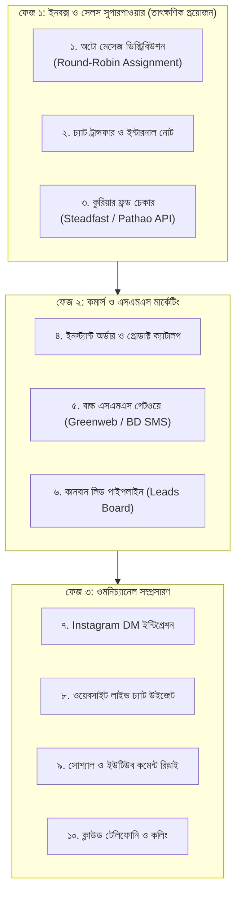

# 📋 সাইমুম সিআরএম — ফিচার স্ট্যাটাস ও ভবিষ্যৎ রোডম্যাপ
> **ডকুমেন্ট তৈরির তারিখ:** ১৫ নভেম্বর ২০২৬  
> **সিস্টেম ভার্সন:** Saimum CRM v0.1.0  
> **উদ্দেশ্য:** সাইমুম সিআরএম-এর বর্তমান সক্ষমতা এবং ভবিষ্যতে যেসব ফিচার ধাপে ধাপে যোগ করা হবে, সেগুলোর বর্তমান অবস্থা ও কারিগরি নির্দেশিকা।

---

## ১. ফিচার স্ট্যাটাস ম্যাট্রিক্স (Overview Matrix)

| ফিচার ক্যাটাগরি | ফিচারের নাম | বর্তমান অবস্থা | প্রয়োজনীয় সময়/প্রচেষ্টা | প্রধান প্রযুক্তি / ডিপেন্ডেন্সি |
| :--- | :--- | :---: | :---: | :--- |
| **টিম ও ইনবক্স** | Multi-Agent Auth & Roles | ✅ সম্পূর্ণ সচল | — | NextAuth, Sessions, DAL |
| **টিম ও ইনবক্স** | অটো মেসেজ ডিস্ট্রিবিউশন (Round-Robin) | 🟡 ভিত্তি প্রস্তুত | সহজ (১-২ দিন) | `assignedToUserId`, Cron/Worker |
| **টিম ও ইনবক্স** | চ্যাট ট্রান্সফার ও কিউ (Queues) | 🟡 ভিত্তি প্রস্তুত | সহজ (১ দিন) | Inbox Dialog, Activity Logs |
| **চ্যানেল** | Facebook Messenger Inbox | ✅ সম্পূর্ণ সচল | — | Meta Graph API v24.0, Webhooks |
| **চ্যানেল** | WhatsApp Coexistence | 🟡 রিভিউ পেন্ডিং | মাঝারি (১ দিন) | Embedded Signup, Cloud API |
| **চ্যানেল** | Instagram Direct Messages | ⏳ বাকি | মাঝারি (২ দিন) | Meta Instagram Graph API |
| **চ্যানেল** | ওয়েবসাইট লাইভ চ্যাট উইজেট | ⏳ বাকি | মাঝারি (২-৩ দিন) | Embeddable React/Vanilla Widget |
| **ই-কমার্স** | কুরিয়ার ফ্রড চেকার (Steadfast/Pathao) | ⏳ বাকি | খুব সহজ (১ দিন) | Courier Public/Partner API |
| **ই-কমার্স** | ইনস্ট্যান্ট অর্ডার ও প্রোডাক্ট ম্যানেজমেন্ট | ⏳ বাকি | মাঝারি (২-৩ দিন) | `orders`, `products` DB Schema |
| **মার্কেটিং** | WhatsApp টেমপ্লেট ব্রডকাস্ট | ✅ ব্যাকএন্ড তৈরি | সহজ (১ দিন) | `src/core/broadcast`, Meta Templates |
| **মার্কেটিং** | লোকাল বাল্ক এসএমএস (Mobile SMS) | ⏳ বাকি | সহজ (১ দিন) | Greenweb / BulkSMSBD API |
| **অটোমেশন** | AI অটো-রিপ্লাই (Claude/OpenAI) | ✅ সম্পূর্ণ সচল | — | `src/core/ai`, Anthropic/OpenAI |
| **অটোমেশন** | সেভড/কুইক রিপ্লাই ও অফিস আওয়ার | ✅ সম্পূর্ণ সচল | — | `/settings/quick-replies`, Holidays |
| **সোশ্যাল** | ফেসবুক ও ইউটিউব কমেন্ট রিপ্লাই | ⏳ বাকি | বড় (৩-৪ দিন) | Meta Page Feed, YouTube Data API |
| **টেলিফোনি** | ভয়েস কলিং (SIP / WhatsApp Call) | ⏳ বাকি | বড় (৫-৭ দিন) | WebRTC / Meta Business Calling |
| **সিআরএম** | কন্টাক্ট ম্যানেজমেন্ট ও সিএসভি ইমপোর্ট | ✅ সম্পূর্ণ সচল | — | `/contacts`, CSV Parser |
| **সিআরএম** | কানবান লিড পাইপলাইন (Leads Board) | ⏳ বাকি | মাঝারি (২ দিন) | Drag-and-drop Kanban, Lifecycle |
| **অ্যানালিটিক্স**| রেসপন্স টাইম ও ভলিউম অ্যানালিটিক্স | ✅ সম্পূর্ণ সচল | — | `/analytics`, Aggregate Queries |

---

## ২. বর্তমানে সাইটে নেই এমন ফিচারগুলোর বিস্তারিত বিবরণ



---

### ফিচার ১: অটো মেসেজ ডিস্ট্রিবিউশন (Round-Robin & Workload Balancing)
* **উদ্দেশ্য:** নতুন মেসেজ আসলে তা স্বয়ংক্রিয়ভাবে একটিভ এজেন্টদের মাঝে সমানভাবে বণ্টন করে দেওয়া (যেমন: ৩ জন এজেন্ট থাকলে ১ম চ্যাট এজেন্ট-১ এ, ২য় চ্যাট এজেন্ট-২ এ)।
* **বর্তমান অবস্থা:** ডাটাবেজে `conversations` টেবিলে `assignedToUserId` ফিল্ড অলরেডি রয়েছে। কিন্তু বর্তমানে ম্যানুয়ালি এসাইন করতে হয়।
* **যা যোগ করতে হবে:**
  1. **লজিক:** `src/core/inbox/assignment.ts` তৈরি করে রাউন্ড-রবিন এলগরিদম যোগ করা।
  2. **সেটিংস:** `/settings/team` পেজে একটি টগল: *"স্বয়ংক্রিয় মেসেজ বন্টন (Auto-distribution) চালু/বন্ধ"* এবং *"প্রতি এজেন্টের সর্বোচ্চ চ্যাট লিমিট (Max Concurrency)"*।
  3. **অটো-রিঅ্যাসাইন:** কোনো এজেন্ট ১৫ মিনিট রেসপন্স না করলে অন্য এজেন্টের কাছে চ্যাট রি-অ্যাসাইন করার ব্যাকগ্রাউন্ড টাস্ক।

---

### ফিচার ২: চ্যাট ট্রান্সফার ও ইন্টারনাল নোট (Internal Team Collaboration)
* **উদ্দেশ্য:** এক এজেন্ট অন্য এজেন্টের কাছে চলমান চ্যাট ফরওয়ার্ড/ট্রান্সফার করতে পারবে এবং চ্যাটের ভেতরে গোপনে দলের সদস্যদের উদ্দেশ্যে নোট লিখে রাখতে পারবে (যা কাস্টমার দেখবে না)।
* **বর্তমান অবস্থা:** ডাটাবেজের স্কিমাতে সাপোর্ট রেডি, কিন্তু ফ্রন্টএন্ড চ্যাট বক্সে ট্রান্সফার বাটন ও ইন্টারনাল নোট টগল নেই।
* **যা যোগ করতে হবে:**
  1. `messages` টেবিলে `isInternal: boolean` কলাম।
  2. চ্যাট ইনবক্সে **"Transfer Chat"** পপআপ বাটন (এজেন্ট সিলেক্ট করে ট্রান্সফার)।
  3. চ্যাটের মেসেজ বক্সের নিচে একটি হলুদ রঙের টগল: *"Internal Note"* (যাতে এজেন্টরা একে অপরের জন্য নির্দেশ লিখে রাখতে পারে)।

---

### ফিচার ৩: কুরিয়ার ফ্রড চেকার (Courier Delivery & Fraud Checker)
* **উদ্দেশ্য:** কাস্টমার অর্ডার করার আগে তার ফোন নম্বর দিয়ে সে অতীতে অন্য কোনো শপ থেকে পার্সেল রিটার্ন করেছে কিনা এবং তার কুরিয়ার ডেলিভারি সাকসেস রেট কত, তা চ্যাটের সাইডবারে সাথে সাথে দেখা।
* **বর্তমান অবস্থা:** সাইটে বর্তমানে নেই।
* **যা যোগ করতে হবে:**
  1. **কুরিয়ার এপিআই কানেক্টর:** Steadfast, Pathao Courier বা BD Fraud Alert-এর পাবলিক বা পার্টনার এপিআই কল ফাংশন (`src/core/courier/fraud-check.ts`)।
  2. **ইনবক্স সাইডবার উইজেট:** কাস্টমার প্রোফাইল কার্ডে একটি রিয়েল-টাইম ব্যাজ:
     - 🟢 **বিশ্বাসযোগ্য ক্রেতা:** ডেলিভারি রেট ৯৫%+ (সফল ডেলিভারি: ৩০, রিটার্ন: ১)
     - 🔴 **ঝুঁকিপূর্ণ ক্রেতা:** ডেলিভারি রেট ৫০% এর নিচে (সফল: ৩, রিটার্ন: ৫)

---

### ফিচার ৪: ইনস্ট্যান্ট অর্ডার ও প্রোডাক্ট ক্যাটালগ (Chat-to-Order)
* **উদ্দেশ্য:** চ্যাটে কথা বলতে বলতেই সাইডবারে কাস্টমারের নাম, ঠিকানা ও প্রোডাক্ট সিলেক্ট করে অর্ডার তৈরি করা এবং কাস্টমারকে তাৎক্ষণিক ইনভয়েস/অর্ডার রসিদ পাঠানো।
* **বর্তমান অবস্থা:** সাইটে বর্তমানে কোনো `orders` বা `products` টেবিল নেই।
* **যা যোগ করতে হবে:**
  1. **ডাটাবেজ স্কিমা:**
     - `products` (id, title, sku, price, stock, active)
     - `orders` (id, contactId, totalAmount, status, courierTrackingCode)
     - `order_items` (orderId, productId, quantity, price)
  2. **ইনবক্স ইন্টিগ্রেশন:** ইনবক্সের ডানপাশে "Create Order" বোতাম। সেখানে ক্লিক করলে ঠিকানা ও পণ্য অটো-ফিল হয়ে এক ক্লিকে অর্ডার কনফার্ম হবে।
  3. **স্বয়ংক্রিয় রসিদ:** অর্ডার ক্রিয়েট হলেই কাস্টমারের হোয়াটসঅ্যাপ/মেসেঞ্জারে মেটা টেমপ্লেট দিয়ে অর্ডার কনফার্মেশন চলে যাবে।

---

### ফিচার ৫: লোকাল বাল্ক এসএমএস গেটওয়ে (Local SMS Gateway)
* **উদ্দেশ্য:** যেসব কাস্টমার হোয়াটসঅ্যাপ বা ফেসবুকে নেই, তাদের ফোনে সরাসরি মেম্বারশিপ, ইভেন্ট নোটিশ বা ডেলিভারি অ্যালার্ট এসএমএস পাঠানো।
* **বর্তমান অবস্থা:** হোয়াটসঅ্যাপের জন্য ব্রডকাস্ট ইঞ্জিন আছে, তবে মোবাইল সিমের এসএমএস গেটওয়ে নেই।
* **যা যোগ করতে হবে:**
  1. `src/channels/sms/adapter.ts`: Greenweb / BulkSMSBD / Onnorokom API দিয়ে এসএমএস পাঠানো ও ডেলিভারি স্ট্যাটাস চেক।
  2. `/marketing/sms` পেজ: নম্বর লিস্ট বা CSV দিয়ে বাল্ক এসএমএস ড্রাফট ও সেন্ড করার ইন্টারফেস।
  3. চ্যাট উইন্ডো থেকে কাস্টমারকে সরাসরি এসএমএস পাঠানোর শর্টকাট।

---

### ফিচার ৬: কানবান লিড পাইপলাইন (Leads CRM Pipeline)
* **উদ্দেশ্য:** কাস্টমারদের স্টেজ অনুযায়ী ড্র্যাগ-অ্যান্ড-ড্রপ কানবান বোর্ডে ট্র্যাক করা (যেমন: *নতুন যোগাযোগ ➔ আগ্রহ দেখিয়েছে ➔ আলোচনা চলছে ➔ মেম্বারশিপ কনফার্মড*)।
* **বর্তমান অবস্থা:** কন্টাক্ট লিস্ট এবং ফিল্টারিং আছে, কিন্তু ভিজ্যুয়াল বোর্ড নেই।
* **যা যোগ করতে হবে:**
  1. `contacts` টেবিলে `pipelineStageId` এবং `stages` কনফিগারেশন টেবিল।
  2. `/leads` পেজে একটি ড্র্যাগ-অ্যান্ড-ড্রপ ইন্টারফেস (Kanban Board)।

---

### ফিচার ৭: Instagram Direct Messages
* **উদ্দেশ্য:** সাইমুমের অফিসিয়াল ইন্সটাগ্রাম একাউন্টের ডিরেক্ট মেসেজগুলো এই একই সেন্ট্রাল ইনবক্সে রিসিভ ও রিপ্লাই করা।
* **বর্তমান অবস্থা:** মেটা অ্যাপে ইন্সটাগ্রাম প্রোডাক্ট যুক্ত করা যায়, আমাদের ইনবক্স অলরেডি ওমনিচ্যানেল।
* **যা যোগ করতে হবে:**
  1. মেটা অ্যাপে `instagram_manage_messages` পারমিশন।
  2. `src/channels/instagram/adapter.ts` তৈরি করা (যা হুবহু আমাদের `src/channels/messenger/adapter.ts` এর মতো একই স্ট্রাকচারে কাজ করবে)।

---

### ফিচার ৮: ওয়েবসাইট লাইভ চ্যাট উইজেট (Website Live Chat)
* **উদ্দেশ্য:** `saimum.org` বা যেকোনো অফিসিয়াল ওয়েবসাইটে একটি ভাসমান চ্যাট বাটন (Floating Widget) থাকবে, যেখান থেকে ভিজিটররা সরাসরি লাইভ চ্যাট করতে পারবে এবং চ্যাটটি আমাদের এই CRM ইনবক্সে চলে আসবে।
* **বর্তমান অবস্থা:** সাইটে নেই।
* **যা যোগ করতে হবে:**
  1. একটি লাইটওয়েট জাভাস্ক্রিপ্ট স্ক্রিপ্ট (`widget.js`), যা যেকোনো সাইটে `<script src="https://crm.saimum.org/widget.js">` বসিয়ে চালু করা যাবে।
  2. রিয়েল-টাইম ওয়েব সকেট বা সার্ভার-সেন্ট ইভেন্টস (SSE) কানেকশন।

---

## ৩. ভবিষ্যতের বাস্তবায়ন পরিকল্পনা ও প্রায়োরিটি গাইড (Roadmap Steps)

```
[এখনকার ফোকাস]
Meta Review Approval  ➔  WhatsApp Coexistence অনবোর্ডিং (Go-Live)
          │
          ▼
[১ম স্প্রিন্ট - Team Efficiency]
অটো মেসেজ ডিস্ট্রিবিউশন (Round-Robin)  +  চ্যাট ট্রান্সফার ও ইন্টারনাল নোট
          │
          ▼
[২য় স্প্রিন্ট - Commerce & Safety]
কুরিয়ার ফ্রড চেকার (Steadfast/Pathao API)  +  ইনস্ট্যান্ট অর্ডার ম্যানেজমেন্ট
          │
          ▼
[৩য় স্প্রিন্ট - Marketing Expansion]
লোকাল বাল্ক এসএমএস গেটওয়ে  +  Instagram DM চ্যানেল
```

> [!TIP]
> এই ডকুমেন্টটি ভবিষ্যতের যেকোনো সময়ে সাইমুম সিআরএম-এর নতুন ফিচার ডেভেলপমেন্ট শুরু করার জন্য ব্লুপ্রিন্ট হিসেবে কাজ করবে। নতুন কোনো ডেভেলপার বা ভবিষ্যতের প্রজেক্ট স্প্রিন্টে সরাসরি এই ডকুমেন্টের প্রতিটি মডিউল ধরে ধরে কোড শুরু করা যাবে।
