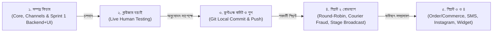
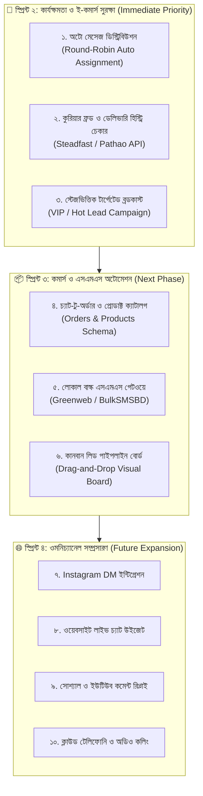

# 📋 সাইমুম সিআরএম — ফিচার স্ট্যাটাস ও সামগ্রিক রোডম্যাপ (Master Status & Roadmap)
> **সর্বশেষ হালনাগাদ:** ১৫ নভেম্বর ২০২৬  
> **সিস্টেম ভার্সন:** Saimum CRM v0.1.0 (স্প্রিন্ট ১ সম্পন্নকরণ পর্যায়)  
> **উদ্দেশ্য:** সাইমুম সিআরএম-এর বর্তমান সক্ষমতা, স্প্রিন্ট ১-এর অর্জিত ফলাফল, বর্তমানে চলমান পরীক্ষা এবং ভবিষ্যতে বাস্তবায়নের জন্য নির্ধারিত ফিচারগুলোর সম্পূর্ণ ও স্বচ্ছ বিবরণী।

---

## ১. সার্বিক সারসংক্ষেপ ড্যাশবোর্ড (System Status Overview)

| ক্যাটাগরি | মোট ফিচার | সম্পন্ন (Done) | চলমান / যাচাই (In Progress) | বাকি / ভবিষ্যৎ (Backlog) |
| :--- | :---: | :---: | :---: | :---: |
| **কোর আর্কিটেকচার ও নিরাপত্তা** | ৬ | ৬ | ০ | ০ |
| **স্প্রিন্ট ১ নতুন ফিচার** | ৫ | ৫ (কোড ও টেস্ট) | ৫ (ব্রাউজার লাইভ টেস্ট) | ০ |
| **কমিউনিকেশন চ্যানেল** | ৪ | ২ (FB, WA) | ০ | ২ (IG, Widget) |
| **টিম ও অটোমেশন** | ৫ | ৩ | ০ | ২ (Round-Robin, Internal Chat) |
| **ই-কমার্স ও কুরিয়ার** | ৩ | ০ | ০ | ৩ (Courier, Orders, Products) |
| **মার্কেটিং ও সিআরএম** | ৫ | ৩ | ০ | ২ (SMS, Kanban Board) |

---

## ২. যা যা কাজ ইতিমধ্যে সম্পন্ন হয়েছে (What is Completed)

### ক. কোর সিস্টেম ও ফাউন্ডেশন (পূর্বের সম্পন্ন কাজ)
1. **আধুনিক টেক স্ট্যাক:** Next.js 16 (App Router, Turbopack, Server Actions), PostgreSQL (Drizzle ORM), PGlite (Docker-free লোকাল ডেভ ও টেস্টে)।
2. **নিরাপত্তা ও অথেন্টিকেশন:** Multi-agent Login, Scrypt পাসওয়ার্ড হ্যাশিং, Session DAL, কঠোর RBAC (Admin vs Agent গার্ড)।
3. **দ্বিভাষিক কাঠামো (i18n):** বাংলা ও ইংরেজি ভাষার সম্পূর্ণ ডিকশনারি সাপোর্ট, জিরো মিসিং কী (`tests/i18n.test.ts` পাস)।
4. **মেটা চ্যানেল ইন্টিগ্রেশন:**
   - **Facebook Messenger:** Meta Graph API v24.0, Webhook রিসিভ ও সিগনেচার ভেরিফিকেশন, পেইজ ইনবক্স।
   - **WhatsApp Business:** Cloud API, Embedded Signup, Coexistence (মোবাইল অ্যাপ + সিআরএম একসাথে), ২৪ ঘণ্টার কাস্টমার সার্ভিস উইন্ডো, মেটা টেমপ্লেট মেসেজিং।
5. **ইনবক্স ও বেসিক অটোমেশন:**
   - রিয়েল-টাইম ওমনিচ্যানেল চ্যাট ইন্টারফেস (টেক্সট, ইমেজ, অডিও, ভিডিও)।
   - কুইক রিপ্লাই / সেভড রিপ্লাই (`/shortcut` মেনু দিয়ে দ্রুত উত্তর)।
   - ঢাকা বিজনেস আওয়ার্স (সকাল ১০টা–রাত ১০টা) এবং ডেটাবেস ভিত্তিক সক্রিয় ছুটির দিন (`holidays`) কনফিগারেশন।
   - কন্টাক্ট ম্যানেজমেন্ট ও CSV ইমপোর্ট।
   - রেসপন্স টাইম ও ভলিউম অ্যানালিটিক্স ড্যাশবোর্ড (`/analytics`)।

---

### খ. স্প্রিন্ট ১-এ যুক্ত হওয়া ৫টি নতুন কোর ফিচার (কোড ও টেস্ট সম্পন্ন)

| ফিচার | বিস্তারিত ও বাস্তবায়ন কারিগরি বিবরণ | ব্যাকএন্ড কোড | ফ্রন্টএন্ড UI | টেস্ট স্থিতি |
| :--- | :--- | :--- | :--- | :---: |
| **১. Unreplied ফিল্টার ও SLA ব্যাজ** | গ্রাহকের শেষ বার্তার পর উত্তর না দেওয়া চ্যাট ফিল্টার। ঢাকা বিজনেস আওয়ার্স (১০টা-১০টা) ও ছুটির দিন বাদ দিয়ে অপেক্ষা সময়ের রঙিন ব্যাজ: `<৫মি` সবুজ, `৫–১৫মি` হলুদ, `>১৫মি` লাল। দ্বিভাষিক সাপোর্ট (`১৫মি অপেক্ষা` / `15m wait`)। | `src/core/inbox/sla.ts` `src/core/inbox/queries.ts` | `src/app/(app)/inbox/inbox-filters.tsx` `conversation-list.tsx` | 🟢 পাস (১২/১২) |
| **২. ডায়নামিক লাইফসাইকেল স্টেজ** | অ্যাডমিনদের জন্য ডাটাবেস-ভিত্তিক স্টেজ তৈরি/এডিট/ডিলিট ড্যাশবোর্ড (`/settings/stages`), ৮টি কনট্রাস্ট-নিরাপদ রঙের পিল (`StagePill`), ইনবক্স হেডারে ১-ক্লিক ড্রপডাউন সিলেক্টর এবং কন্টাক্ট ফিল্টার। | `src/core/contacts/stages.ts` `drizzle/0013_safe_switch.sql` | `src/app/(app)/settings/stages/` `stage-selector.tsx` `stage-pill.tsx` | 🟢 পাস |
| **৩. AI ড্রাফট অ্যাসিস্ট্যান্ট** | কম্পোজারের মেসেজ ইনপুটে `✨ AI খসড়া` বাটন। গ্রাহকের মেসেজ `<customer_message>` ট্যাগে মোড়ানো (প্রম্পট ইনজেকশন গার্ড)। প্রতি মিনিটে ১০টি রেট লিমিট। প্রোভাইডার/জ্ঞানভাণ্ডার না থাকলে বাটন নিষ্ক্রিয় ও টুলটিপে কারণ প্রদর্শন। | `src/core/ai/draft.ts` `src/core/inbox/actions.ts` | `src/app/(app)/inbox/client-bits.tsx` | 🟢 পাস |
| **৪. চ্যাট ট্রান্সফার ও অভ্যন্তরীণ নোট** | ইনবক্স হেডারে ট্রান্সফার ডায়ালগ। কঠোর RBAC (এজেন্ট শুধু নিজের চ্যাট ট্রান্সফার করতে পারে, অ্যাডমিন যেকোনো চ্যাট)। স্বয়ংক্রিয় বট পজ (`botPaused = true`) এবং `conversation_notes` টেবিলে অভ্যন্তরীণ নোট সংরক্ষণ। | `src/core/inbox/transfer.ts` `src/core/inbox/actions.ts` | `src/app/(app)/inbox/transfer-dialog.tsx` `conversation-view.tsx` | 🟢 পাস |
| **৫. সিকিউর কন্টাক্টস CSV এক্সপোর্ট** | অ্যাডমিন-অনলি এক্সপোর্ট মডাল। শেষ যোগাযোগের তারিখ ও স্টেজ ফিল্টারিং। ১ কন্টাক্ট = ১ রো (মাল্টিপল আইডি `string_agg` দিয়ে যুক্ত)। UTF-8 BOM ও OWASP ফর্মুলা ইনজেকশন স্যানিটাইজার। Zod ইনপুট ভ্যালিডেশন। | `src/core/contacts/export.ts` `src/core/contacts/actions.ts` | `src/app/(app)/contacts/export-contacts-button.tsx` `contacts/page.tsx` | 🟢 পাস |

---

### গ. স্বয়ংক্রিয় পরীক্ষা ও কোয়ালিটি গেট ফলাফল
- **TypeScript (`npm run typecheck`):** ০ ত্রুটি।
- **ESLint (`npm run lint`):** ০ ওয়ার্নিং, ০ ত্রুটি।
- **i18n অনুবাদ (`tests/i18n.test.ts`):** ৭/৭ টেস্ট পাস।
- **সম্পূর্ণ টেস্ট স্যুট (`npm run test`):** ৩৭টি টেস্ট ফাইল, ৩৮৮/৩৮৮ টেস্ট পাস (~১৮.৩ সেকেন্ড)।
- **গিট ব্যাকএন্ড কমিট:** কমিট হ্যাশ `e43b292` (`feat(sprint1): implement backend core, schema, and tests for sprint 1 features`)।

---

## ৩. যা যা কাজ বর্তমানে চলমান / যাচাইয়ের অপেক্ষায় (In Progress)

নিচের কাজগুলো কোড করা শেষ হলেও এখনো চূড়ান্তভাবে সমাপ্ত (Closed) ঘোষণা করা হয়নি:

1. **ব্রাউজারে লাইভ অ্যান্ড-টু-অ্যান্ড ভেরিফিকেশন (Human E2E Testing):**
   - ব্যবহারকারী বর্তমানে লোকাল ডেভ সার্ভারে (`npm run dev:db` ও `npm run dev`) ব্রাউজারে ৫টি ফিচার ব্যবহার করে দেখছেন।
   - **চেকলিস্ট:**
     - [ ] ইনবক্সে "উত্তর-না-পাওয়া" ফিল্টারে গ্রাহকের উত্তর না দেওয়া চ্যাট ফিল্টার হওয়া।
     - [ ] কার্ডে SLA ব্যাজের রং ও ভাষা পরিবর্তন (English ↔ বাংলা) যাচাই।
     - [ ] `/settings/stages`-এ স্টেজ তৈরি ও ইনবক্স হেডার ড্রপডাউনে তা পরিবর্তন।
     - [ ] এজেন্টের নিজের চ্যাট হ্যান্ডওভার নোট সহ ট্রান্সফার ও বট পজ হওয়া।
     - [ ] AI প্রোভাইডার না থাকলে বাটন নিষ্ক্রিয় থাকা ও টুলটিপ দেখা।
     - [ ] কন্টাক্ট পেজ থেকে ফিল্টার সহ CSV ডাউনলোড ও Excel-এ বাংলা ফন্ট অক্ষত থাকা।
2. **ফ্রন্টএন্ড UI লোকাল গিট কমিট:**
   - ব্রাউজার পরীক্ষায় কোনো সমস্যা না থাকলে আন-কমিটেড ২১-২৫টি ফ্রন্টএন্ড ফাইল লোকাল গিটে সংরক্ষণ করা।
3. **রিমোট রিপোজিটরিতে কোড পুশ (`git push`):**
   - ব্যবহারকারীর সুনির্দিষ্ট অনুমতি পাওয়ার পর `git push` কার্যকর করা।

---

## ৪. যা যা কাজ এখনো করা হয়নি (Pending & Future Roadmap)

পরবর্তী স্প্রিন্টগুলোর জন্য নির্ধারিত ফিচারগুলোকে ব্যবসায়িক মূল্য ও বাস্তবায়নের সহজতার ভিত্তিতে তিন ভাগে ভাগ করা হয়েছে:

---

### বিস্তারিত ভবিষ্যৎ ফিচার পরিকল্পনা:

#### ১. অটো মেসেজ ডিস্ট্রিবিউশন (Round-Robin & Workload Balancing) — *স্প্রিন্ট ২*
* **উদ্দেশ্য:** নতুন মেসেজ আসলে তা স্বয়ংক্রিয়ভাবে একটিভ ও অনলাইন এজেন্টদের মাঝে সমানভাবে বণ্টন করে দেওয়া (যেমন: ৩ জন এজেন্ট থাকলে ১ম চ্যাট এজেন্ট-১ এ, ২য় চ্যাট এজেন্ট-২ এ)।
* **বর্তমান অবস্থা:** ডাটাবেজে `conversations.assignedUserId` ফিল্ড আছে। কিন্তু বর্তমানে ম্যানুয়ালি এসাইন করতে হয়।
* **যা যোগ করতে হবে:**
  1. `src/core/inbox/assignment.ts`: রাউন্ড-রবিন অ্যালগরিদম ও ম্যাক্স কনকারেন্সি লিমিট (প্রতি এজেন্টের সর্বোচ্চ চ্যাট সংখ্যা)।
  2. `/settings/team` পেজে একটি টগল: *"স্বয়ংক্রিয় মেসেজ বণ্টন (Auto-distribution) চালু/বন্ধ"*।
  3. ইনজেস্ট পাইপলাইনে (`ingest.ts`) নতুন কন্টাক্ট তৈরিতে স্বয়ংক্রিয় অ্যাসাইনমেন্ট ট্রিগার।

#### ২. কুরিয়ার ফ্রড ও ডেলিভারি হিস্ট্রি চেকার (Courier Delivery & Fraud Checker) — *স্প্রিন্ট ২*
* **উদ্দেশ্য:** কাস্টমার অর্ডার কনফার্ম করার আগে তার ফোন নম্বর দিয়ে সে অতীতে অন্য কোনো অনলাইন শপ থেকে পার্সেল রিটার্ন করেছে কিনা এবং তার কুরিয়ার ডেলিভারি সাকসেস রেট কত, তা ইনবক্সের সাইডবারে সাথে সাথে দেখা।
* **বর্তমান অবস্থা:** সাইটে বর্তমানে নেই।
* **যা যোগ করতে হবে:**
  1. **কুরিয়ার এপিআই কানেক্টর:** Steadfast / Pathao Courier / BD Fraud Alert-এর এপিআই কল ফাংশন (`src/core/courier/fraud-check.ts`)।
  2. **ইনবক্স সাইডবার উইজেট:** কাস্টমার প্রোফাইল কার্ডে একটি রিয়েল-টাইম স্ট্যাটাস ব্যাজ:
     - 🟢 **বিশ্বাসযোগ্য ক্রেতা:** ডেলিভারি রেট ৯৫%+ (সফল ডেলিভারি: ৩০, রিটার্ন: ১)
     - 🔴 **ঝুঁকিপূর্ণ ক্রেতা:** ডেলিভারি রেট ৫০% এর নিচে (সফল: ৩, রিটার্ন: ৫)

#### ৩. স্টেজভিত্তিক টার্গেটেড ব্রডকাস্ট (Stage-based Broadcast Segmentation) — *স্প্রিন্ট ২*
* **উদ্দেশ্য:** স্প্রিন্ট ১-এ তৈরিকৃত লাইফসাইকেল স্টেজ (যেমন: VIP, Hot Lead, Prospect) অনুযায়ী নির্দিষ্ট কাস্টমার গ্রুপকে টার্গেট করে WhatsApp মেটা টেমপ্লেট ব্রডকাস্ট পাঠানো।
* **বর্তমান অবস্থা:** ব্রডকাস্ট ইঞ্জিন আছে কিন্তু তা শুধু ট্যাগ বা সব কন্টাক্টে পাঠানো যায়; স্টেজ ফিল্টারিং নেই।
* **যা যোগ করতে হবে:**
  1. ব্রডকাস্ট ক্রিয়েট পেজে (`/broadcasts/new`) কন্টাক্ট ফিল্টারে "লাইফসাইকেল স্টেজ" মাল্টি-সিলেক্ট ড্রপডাউন।
  2. ব্রডকাস্ট অডিয়েন্স জেনারেশন কোয়েরিতে `contacts.stageId IN (...)` ফিল্টার কার্যকর করা।

#### ৪. ইনস্ট্যান্ট অর্ডার ও প্রোডাক্ট ক্যাটালগ (Chat-to-Order) — *স্প্রিন্ট ৩*
* **উদ্দেশ্য:** ইনবক্সে কথা বলতে বলতেই সাইডবার থেকে প্রোডাক্ট সিলেক্ট করে অর্ডার তৈরি করা এবং কাস্টমারকে তাৎক্ষণিক ইনভয়েস/রসিদ পাঠানো।
* **বর্তমান অবস্থা:** সাইটে বর্তমানে কোনো `orders` বা `products` টেবিল নেই।
* **যা যোগ করতে হবে:**
  1. ডাটাবেজ স্কিমা: `products`, `orders`, `order_items`।
  2. ইনবক্সের ডানপাশে "Create Order" বোতাম ও অর্ডার সামারি কার্ড।

#### ৫. লোকাল বাল্ক এসএমএস গেটওয়ে (Local SMS Gateway) — *স্প্রিন্ট ৩*
* **উদ্দেশ্য:** যেসব কাস্টমার হোয়াটসঅ্যাপ বা ফেসবুকে সক্রিয় নেই, তাদের ফোনে সরাসরি মেম্বারশিপ, ইভেন্ট নোটিশ বা ডেলিভারি অ্যালার্ট এসএমএস পাঠানো।
* **বর্তমান অবস্থা:** সাইটে সিম এসএমএস গেটওয়ে নেই।
* **যা যোগ করতে হবে:**
  1. `src/channels/sms/adapter.ts`: Greenweb / BulkSMSBD API ইন্টিগ্রেশন।
  2. বাল্ক এসএমএস ড্রাফট ও ক্যাম্পেইন ইন্টারফেস।

#### ৬. কানবান লিড পাইপলাইন বোর্ড (Kanban Leads Pipeline) — *স্প্রিন্ট ৩*
* **উদ্দেশ্য:** কাস্টমারদের স্টেজগুলোকে ভিজ্যুয়াল ড্র্যাগ-অ্যান্ড-ড্রপ কানবান বোর্ডে পরিচালনা করা (যেমন: Trello/Jira-র মতো লিড পাইপলাইন)।
* **বর্তমান অবস্থা:** স্টেজ টেবিল ও ড্রপডাউন সম্পন্ন, কিন্তু ড্র্যাগ-অ্যান্ড-ড্রপ কানবান ভিউ নেই।

#### ৭. ওমনিচ্যানেল সম্প্রসারণ (Instagram, Live Chat, Comments, Calling) — *স্প্রিন্ট ৪*
* Instagram Direct Messages ইন্টিগ্রেশন।
* ওয়েবসাইটের জন্য Embeddable লাইভ চ্যাট উইজেট।
* ফেসবুক পোস্ট ও ইউটিউব ভিডিও কমেন্ট অটো-রিপ্লাই।
* ক্লাউড টেলিফোনি ও ভয়েস কলিং (SIP / WhatsApp Voice)।
