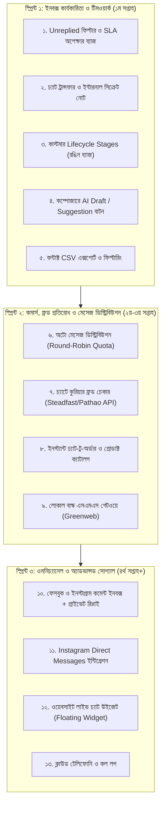

# 📊 Talkly (demo.talkly.bd) বনাম Saimum CRM — পূর্ণাঙ্গ বেঞ্চমার্ক ও ফিচার পরিকল্পনা

> **সর্বশেষ হালনাগাদ:** ১৫ নভেম্বর ২০২৬  
> **বিশ্লেষণের ভিত্তি:** Talkly-র লাইভ ডেমো পরিবেশের বাস্তব ইন্টারফেস পরীক্ষণ এবং সাইমুম সিআরএম-এর বর্তমান আর্কিটেকচার পর্যালোচনা।  
> **মূল উদ্দেশ্য:** বাংলাদেশি বাজারে জনপ্রিয় কমার্শিয়াল সিআরএম Talkly-র সুবিধাগুলোকে সাইমুম সিআরএম-এর নিজস্ব, ওপেন ও স্বাবলম্বী প্ল্যাটফর্মে আরও উন্নত ও কাস্টমাইজডভাবে রূপদান করা।

---

## ১. Talkly-র মডিউলভিত্তিক পরীক্ষণ ফলাফল

| মডিউল | Talkly-তে যা যা দেখা গেছে | সাইমুম সিআরএম-এর বর্তমান অবস্থা | ফাঁক / মূল পার্থক্য |
| :--- | :--- | :--- | :--- |
| **১. সেন্ট্রাল ইনবক্স** | WhatsApp, Messenger, Instagram, Live Chat এক তালিকায়। নতুন, অপঠিত, **Unreplied (উত্তর না পাওয়া)** ফিল্টার। | WhatsApp + Messenger এক ইনবক্সে সচল। সর্টিং ও বেসিক ফিল্টার আছে। | **Unreplied ফিল্টার**, অপেক্ষার সময় (SLA) ব্যাজ এবং ইনবক্সের ভেতর সার্চ নেই। |
| **২. কাস্টমার লাইফসাইকেল** | রঙিন ব্যাজে স্টেজ: *New Lead → Qualified → Interested → Payment Pending → Customer* (+ Lost/No Response)। ড্রপডাউনে পরিবর্তনযোগ্য। | কন্টাক্ট ট্যাগ ও স্ট্যাটাস আছে, তবে কোনো নির্দিষ্ট লাইফসাইকেল বা কানবান স্টেজ নেই। | **Lifecycle Stages** এবং ইনবক্স থেকে স্টেজ পরিবর্তনের ড্রপডাউন নেই। |
| **৩. মেসেজ বণ্টন (Distribution)** | ৯০০ মেসেজ ৩ জন এজেন্টের মধ্যে ৩০০ করে ভাগ করে দেওয়ার অটোমেটিক লোড-ব্যালেন্সিং ও রাউন্ড-রবিন ডিস্ট্রিবিউশন। | কনভারসেশনে `assignedToUserId` ফিল্ড আছে, তবে এটি ম্যানুয়ালি করতে হয়। | **অটোমেটিক রাউন্ড-রবিন বণ্টন ও এজেন্টের কোটা (Quota) লিমিট** নেই। |
| **৪. চ্যাট একশন ও হেডার** | Open / Pending / Resolved স্ট্যাটাস, ইন্টারনাল নোট, চ্যাট ট্রান্সফার, অপঠিত চিহ্নিতকরণ, SIP/WhatsApp কল বোতাম। | Open/Resolved স্ট্যাটাস, এসাইন ও ইন্টারনাল নোটের ব্যাকএন্ড প্রস্তুত। | চ্যাট **Transfer Dialog** এবং ক্লিয়ার ইন্টারনাল নোটের ফ্রন্টএন্ড UI নেই। |
| **৫. কম্পোজার ও এআই** | ফাইল, ইমোজি, **AI Reply বোতাম** (খসড়া সাজেশন), সেভড রিপ্লাই (`/শর্টকাট`), ভয়েস মেসেজ, এসএমএস ড্রাফট। | টেক্সট, অ্যাটাচমেন্ট ও মিডিয়া প্লেয়ার, কুইক রিপ্লাই (`/shortcode`), ব্যাকএন্ড এআই অটো-বট। | কম্পোজারে এজেন্টের ব্যবহারের জন্য **"AI Draft / Suggestion" বাটন** নেই। |
| **৬. সোশ্যাল কমেন্ট ইনবক্স** | Facebook / Instagram / YouTube পোস্টের কমেন্ট এক ইনবক্সে। Public Reply, **Message Privately (ইনবক্সে আনা)**, Hide/Delete। | মেটা পেজের `feed` সাবস্ক্রিপশন প্রস্তুত, তবে কোনো কমেন্ট ইনবক্স UI নেই। | **Social Comments Inbox** এবং কমেন্টকারীকে সরাসরি প্রাইভেট ইনবক্সে নেওয়ার ফিচার নেই। |
| **৭. কুরিয়ার ফ্রড যাচাই** | চ্যাট উইন্ডো থেকেই কাস্টমারের মোবাইল নম্বর দিয়ে Steadfast/Pathao-এর ডেলিভারি সাকসেস ও রিটার্ন হিস্ট্রি যাচাই। | সাইটে বর্তমানে নেই। | **Courier Fraud Check Integration** নেই। |
| **৮. ইনস্ট্যান্ট অর্ডার ও ক্যাটালগ** | চ্যাট থেকে অর্ডার তৈরি (নম্বর TLK-1001, পণ্য, দাম, ডেলিভারি ঠিকানা, প্রায়োরিটি, স্ট্যাটাস, এজেন্ট পারফরম্যান্স)। | সাইটে বর্তমানে কোনো `orders` বা `products` মডিউল নেই। | **Chat-to-Order ও Product Catalog** নেই। |
| **৯. টিম ও এজেন্ট প্রেজেন্স** | এজেন্টদের লাইভ স্ট্যাটাস: Available, Busy, On Call, In Chat, Unavailable। | `/settings/team` এ অ্যাডমিন/এজেন্ট রোল ও একাউন্ট ম্যানেজমেন্ট আছে। | **এজেন্টের লাইভ Presence ও একটিভ চ্যাট কাউন্ট** নেই। |
| **১০. লোকাল বাল্ক এসএমএস** | যে কাউকে সরাসরি মোবাইল সিমে ব্র্যান্ডেড বাল্ক এসএমএস পাঠানোর সুবিধা। | হোয়াটসঅ্যাপ টেমপ্লেট ব্রডকাস্ট ইঞ্জিন আছে, তবে মোবাইল সিমের এসএমএস গেটওয়ে নেই। | **Local SMS Gateway (Greenweb/BulkSMSBD)** নেই। |
| **১১. টেলিফোনি ও কলিং** | SIP কল ও WhatsApp Calling: My calls, Live queue, Call recording, Missed callbacks। | ভয়েস অডিও প্লেয়ার ও ডাউনলোড আছে, তবে সরাসরি লাইভ কলিং নেই। | **WebRTC / SIP Calling** নেই। |
| **১২. ডেমো অনবোর্ডিং UX** | মাত্র ৪টি ঘর দিয়ে নমুনা ডেটাসহ ডেমো ওয়ার্কস্পেস চালু (লগইন পাসওয়ার্ড ছাড়া)। | `db:seed-dev` স্ক্রিপ্ট আছে। | সহজে ট্রায়াল বা ট্রেনিং দেওয়ার মত ইন-ব্রাউজার ডেমো মোড নেই। |

---

## ২. সাইমুম সিআরএম-এর বর্তমান তুলনামূলক সুবিধা (Our Unfair Advantages)

Talkly-র চেয়ে সাইমুম সিআরএম প্রযুক্তিগত ও কৌশলগতভাবে নিচের দিকগুলোতে বহুলাংশে এগিয়ে:

1. **১০০% জিরো সফটওয়্যার সাবস্ক্রিপশন ফি (No Recurring License Cost):**
   - Talkly প্রতি মাসে ৩–৫ জন এজেন্টের জন্য **৫,০০০ থেকে ১৫,০০০+ টাকা** মাসিক চার্জ কাটে।
   - সাইমুম সিআরএম নিজস্ব VPS সার্ভারে লাইফটাইম ফ্রিতে চলছে। ১০০ জন এজেন্ট ব্যবহার করলেও কোনো সফটওয়্যার ফি নেই।
2. **সম্পূর্ণ ডেটা সিকিউরিটি ও প্রাইভেসি:**
   - গ্রাহকের ফোন নম্বর, ব্যক্তিগত কথোপকথন ও অর্ডার ডেটা কোনো থার্ড-পার্টি কোম্পানির হাতে যায় না। সম্পূর্ণ ডেটাবেজ সাইমুমের নিয়ন্ত্রণে।
3. **আধুনিক ও পরিষ্কার টেক-স্ট্যাক:**
   - Next.js 16 (App Router), React 19, Drizzle ORM, TailwindCSS v4 এবং PostgreSQL।
   - Talkly-র ডেমোতে দেখা গেছে তাদের নেভিগেশন URL-ভিত্তিক নয় (`?section=` পরিবর্তন করলে হিস্ট্রি থাকে না) এবং পেজ লোডে "Loading workspace…" স্পিনার আসে। সাইমুম সিআরএম সম্পূর্ণ URL-ড্রিভেন এবং হাইপার-ফাস্ট।
4. **অফিশিয়াল মেটা কমপ্লায়েন্স ও Coexistence:**
   - সাইমুম সিআরএম মেটার অফিশিয়াল Cloud API ও **WhatsApp Coexistence (Embedded Signup)** আর্কিটেকচারে তৈরি, ফলে মোবাইল থেকে WhatsApp Business অ্যাপ আনইনস্টল করতে হয় না।

---

## ৩. ফিচার বাস্তবায়নের অগ্রাধিকার পরিকল্পনা (Sprint Roadmap)

ব্যবসায়িক লাভ (ROI), বাস্তবায়নের সহজতা এবং ঝুঁকি বিবেচনা করে ফিচারগুলোকে ৩টি ধাপে ভাগ করা হয়েছে:



---

### স্প্রিন্ট ১: ইনবক্স কার্যকারিতা ও টিমওয়ার্ক (Quick Wins — ১ সপ্তাহ)
> *এই ফিচারগুলো তৈরি করতে খুব কম সময় লাগবে কিন্তু ইনবক্সের কার্যক্ষমতা দ্বিগুণ করে দেবে।*

1. **Unreplied ফিল্টার ও SLA ব্যাজ:**
   - ইনবক্সের উপরে একটি ট্যাব: **"Unreplied"** (যেসব মেসেজের উত্তর এজেন্ট এখনো দেয়নি)।
   - প্রতিটি চ্যাট কার্ডে অপেক্ষার সময় দেখানো: যেমন `১২ মিনিট ধরে অপেক্ষমান` (লাল বা হলুদ ব্যাজে)।
2. **চ্যাট ট্রান্সফার ও ইন্টারনাল সিক্রেট নোট:**
   - চ্যাট হেডারে "Transfer" বাটন, যেখান থেকে অন্য এজেন্ট সিলেক্ট করে নোটসহ ট্রান্সফার করা যাবে।
   - মেসেজ বক্সে "Internal Note" মোড (হলুদ ব্যাকগ্রাউন্ড), যা কেবল দলের সদস্যরা দেখবে, কাস্টমার দেখবে না।
3. **কাস্টমার Lifecycle Stages:**
   - চ্যাট হেডারে ড্রপডাউন: `New Lead` (নীল), `Interested` (হলুদ), `Payment Pending` (কমলা), `Customer` (সবুজ), `Lost` (ধূসর)।
   - কন্টাক্ট ও ইনবক্সে স্টেজ অনুযায়ী ফিল্টার করার সুবিধা।
4. **কম্পোজারে AI Draft বাটন:**
   - মেসেজ লেখার ইনপুটের পাশে একটি ছোট স্পার্কল আইকন (✨ **AI Draft**)।
   - ক্লিক করলে সাইমুমের নিজস্ব জ্ঞানভান্ডার থেকে গ্রাহকের শেষ মেসেজের ভিত্তিতে একটি খসড়া উত্তর লিখে দেবে; এজেন্ট সেটি প্রয়োজনে সম্পাদনা করে পাঠাতে পারবে।
5. **কন্টাক্ট CSV এক্সপোর্ট ও ফিল্টারিং:**
   - কন্টাক্ট লিস্টে ফিল্টার করা ডেটা এক ক্লিকে `.csv` ফাইলে ডাউনলোড করা।

---

### স্প্রিন্ট ২: কমার্স, ফ্রড প্রতিরোধ ও ডিস্ট্রিবিউশন (High Business Value — ২-৩ সপ্তাহ)
> *এই ফিচারগুলো সরাসরি সাইমুমের সেলস, অর্ডার এবং দলের কাজের সমবণ্টন নিশ্চিত করবে।*

1. **অটো মেসেজ ডিস্ট্রিবিউশন (Round-Robin & Load Balancing):**
   - যেমন: ৯০০টি নতুন মেসেজ আসলে তা স্বয়ংক্রিয়ভাবে ৩ জন অন-ডিউটি এজেন্টের মধ্যে ৩০০ করে ভাগ হয়ে যাবে।
   - সেটিংস থেকে "Max Active Chats per Agent" (যেমন: এক সাথে সর্বোচ্চ ৩০টি) নির্ধারণের সুযোগ।
2. **চ্যাটে কুরিয়ার ফ্রড চেকার (Steadfast / Pathao Fraud Checker):**
   - ইনবক্সের কাস্টমার প্যানেলে স্বয়ংক্রিয়ভাবে দেখানো হবে:
     - 🟢 **বিশ্বাসযোগ্য কাস্টমার:** ডেলিভারি রেট ৯৬% (২৮টি সফল, ১টি রিটার্ন)।
     - 🔴 **ঝুঁকিপূর্ণ কাস্টমার:** ডেলিভারি রেট ৪২% (৩টি সফল, ৫টি রিটার্ন — সতর্ক থাকুন!)।
3. **ইনস্ট্যান্ট চ্যাট-টু-অর্ডার ও প্রোডাক্ট ক্যাটালগ:**
   - ইনবক্সের সাইডবারে "Create Order" ফর্ম। কাস্টমারের সাথে কথা বলতে বলতেই পণ্য, পরিমাণ, ছাড় ও কুরিয়ার অ্যাড্রেস সিলেক্ট করে অর্ডার জেনারেট।
   - অর্ডার সম্পন্ন হওয়ামাত্রই কাস্টমারের হোয়াটসঅ্যাপ/মেসেঞ্জারে স্বয়ংক্রিয় ইনভয়েস চলে যাবে।
4. **লোকাল বাল্ক এসএমএস গেটওয়ে:**
   - Greenweb বা BulkSMSBD এপিআই ইন্টিগ্রেট করে এক ক্লিকে হাজার হাজার কন্টাক্টকে অফিসিয়াল নোটিশ বা ইভেন্ট মেসেজ পাঠানো।

---

### স্প্রিন্ট ৩: ওমনিচ্যানেল ও সোশ্যাল সম্প্রসারণ (Advanced Channels — ৪র্থ সপ্তাহ+)

1. **সোশ্যাল কমেন্ট ইনবক্স (Facebook & Instagram Comments):**
   - ফেসবুক পোস্টের নিচে মানুষ যেসব কমেন্ট করে, তা ইনবক্সের মতো এক জায়গায় আসবে।
   - সেখান থেকেই **Public Reply** দেওয়া যাবে এবং **"Message Privately"** বাটনে ক্লিক করে কমেন্টকারীকে সরাসরি ইনবক্স চ্যাটে এনে সেলস কনভার্ট করা যাবে।
2. **Instagram Direct Messages (IG DMs):**
   - মেটা অ্যাপের মাধ্যমে একই ইনবক্সে ইনস্টাগ্রাম চ্যাট অন্তর্ভুক্ত করা।
3. **ওয়েবসাইট লাইভ চ্যাট উইজেট:**
   - `saimum.org` বা যেকোনো ওয়েবসাইটে একটি লাইভ চ্যাট স্ক্রিপ্ট বসিয়ে সরাসরি ওয়েব ভিজিটরদের সাথে ইনবক্স থেকে কথা বলা।

---

## ৪. কারিগরি বাস্তবায়ন স্থাপত্য (Technical Architecture Plan)

```
src/
├── channels/
│   ├── messenger/          # সচল (Graph API v24.0)
│   ├── whatsapp/           # সচল (Coexistence + Cloud API)
│   ├── instagram/          # [পরিকল্পিত] Instagram Graph Adapter
│   └── sms/                # [পরিকল্পিত] Greenweb / BD SMS Gateway Adapter
├── core/
│   ├── inbox/
│   │   ├── assignment.ts   # [পরিকল্পিত] Round-Robin Auto-distribution Engine
│   │   ├── lifecycle.ts    # [পরিকল্পিত] Customer Stage Management
│   │   └── transfer.ts     # [পরিকল্পিত] Chat Transfer & History
│   ├── courier/            # [পরিকল্পিত] Steadfast / Pathao Fraud Lookup
│   │   ├── client.ts
│   │   └── fraud-check.ts
│   ├── orders/             # [পরিকল্পিত] Products & Orders Domain
│   │   ├── schema.ts
│   │   └── actions.ts
│   └── social/             # [পরিকল্পিত] Comment Ingest & Private Reply
```

---

## ৫. মূল পর্যবেক্ষণ ও সিদ্ধান্ত (Core Takeaways)

1. **Talkly-র ডেমো দেখার পর স্পষ্ট যে—তাদের মূল আকর্ষণ কেবল মেসেজিং নয়, বরং "ইনবক্সের ভেতর সেলস টুলস" (অর্ডার, ফ্রড চেক, স্টেজ)।**
2. সাইমুম সিআরএম-এর মূল ইঞ্জিন (ইনবক্স, মেটা চ্যানেল, এআই, ব্রডকাস্ট) ইতোমধ্যে অত্যন্ত শক্তিশালী।
3. **স্প্রিন্ট ১ (Unreplied ফিল্টার, স্টেজ, এআই ড্রাফট ও চ্যাট ট্রান্সফার)** যোগ করলেই সাইমুম সিআরএম ব্যবহারকারী এজেন্টদের অভিজ্ঞতা Talkly-র চেয়েও স্মুথ ও আধুনিক হবে।
4. **স্প্রিন্ট ২ (ফ্রড চেক ও অর্ডার)** যোগ করলে সাইমুম শিল্পীগোষ্ঠীর সামগ্রিক যোগাযোগ ও সেলস কার্যক্রম সম্পূর্ণ স্বয়ংসম্পূর্ণ হয়ে উঠবে।
